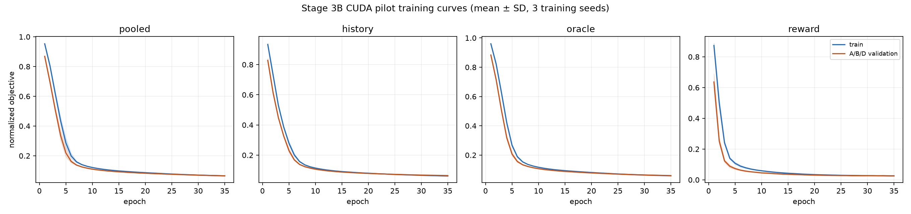
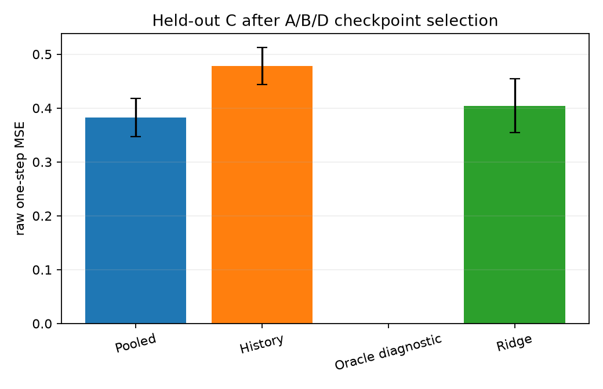
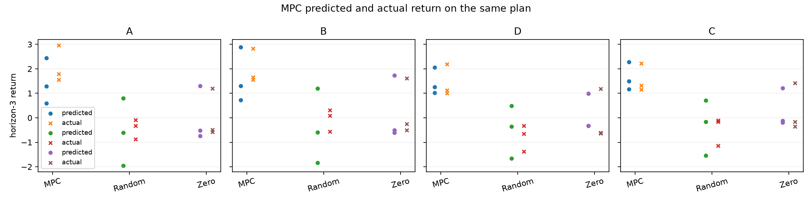

# RWT Stage 3B — Controlled GPU Pilot

## Scope and protocol

This is a controlled pilot, not a full MuJoCo benchmark. The training dataset is the original Stage 3A split: 1,800 train and 200 validation transitions for each of A, B, and D. C is absent from offline data, normalization, validation, and checkpoint selection. Checkpoints were selected separately per method using only A/B/D validation loss. C appears only in the fixed post-selection evaluation episodes.

The GPU config runs three training seeds (`41, 42, 43`) with three independent CUDA worker processes. Each worker owns its CUDA context and trains one model at a time. Data is resident on the GPU during minibatch updates. The methods use the same normalized state-delta objective: pooled MLP, history-conditioned MLP (past observed transitions only), and oracle-regime-conditioned MLP (diagnostic only). A linear ridge model is the reference. Reward is fit by a separate network and separate objective.

Evaluation uses held-out seeds `821–823`, rollout seeds `801–803`, and MPC seeds `811–813`. The held-out transition set is regenerated deterministically from those seeds and is not saved into training data. The MPC horizon is 3 with 32 CEM candidates and 2 optimization rounds, using the same initial simulator states and action sequences for predicted and actual returns. CEM actions are bounded by the environment limits `[-1, 1]` per action dimension.

## GPU environment and training

| Item | Result |
|---|---:|
| GPU | NVIDIA GeForce RTX 5060, 8 GB |
| Python / PyTorch | 3.12.14 / 2.11.0+cu128 |
| CUDA runtime / Gymnasium / MuJoCo | 12.8 / 1.4.0 / 3.16.0 |
| CUDA tensor, forward/backward, save/load, resume smoke | Passed |
| Pilot training workers | 3 spawned CUDA processes |
| Total training wall time | 8.82 s |
| Peak allocated VRAM per model | 18.7–20.8 MiB |
| Peak reserved VRAM per model | 24 MiB |
| Max sampled GPU utilization | 98% |
| Max sampled GPU memory | 542 MiB |

The utilization file spans several short pilot attempts and idle intervals, so its overall mean is not a measure of utilization during the final training run. The workload is very small: GPU utilization reached 90–98% during minibatch bursts and fell to zero between jobs. Adding workers beyond the three independent seed workers would increase contention and would not make this smoke-sized experiment a meaningful full-GPU workload.

Training time and best validation loss are recorded per model/seed in `training_runs.csv`; per-epoch train/validation objectives are in `training_curves.csv`. The selected seeds were pooled 41, history 41, oracle diagnostic 42, and reward 43. The model parameter counts are pooled 6,801, history 11,409, oracle 6,993, and reward 5,761. The oracle model receives one-hot A/B/D labels only in diagnostic training/evaluation and is not a deployable result.



## One-step prediction

Entries are raw MSE (normalized state-delta MSE), mean over three training seeds for learned methods. Validation rows use the 200 A/B/D transitions per regime. Held-out rows use three training seeds crossed with the same three post-selection evaluation seeds; reported SD is descriptive over those runs.

| Regime / split | Pooled | History | Oracle diagnostic | Ridge |
|---|---:|---:|---:|---:|
| A validation | 0.417 (0.0742) | 0.431 (0.0761) | 0.416 (0.0733) | 0.484 (0.1041) |
| B validation | 0.453 (0.0810) | 0.460 (0.0809) | 0.413 (0.0780) | 0.497 (0.1081) |
| D validation | 0.231 (0.0414) | 0.205 (0.0367) | 0.143 (0.0280) | 0.287 (0.0559) |
| A held-out episodes | 0.634 ± 0.060 | 0.683 ± 0.088 | 0.597 ± 0.068 | 0.678 ± 0.069 |
| B held-out episodes | 0.712 ± 0.112 | 0.752 ± 0.116 | 0.649 ± 0.113 | 0.744 ± 0.142 |
| D held-out episodes | 0.339 ± 0.016 | 0.426 ± 0.034 | 0.244 ± 0.023 | 0.346 ± 0.001 |
| C held-out only | 0.382 ± 0.035 | 0.478 ± 0.035 | — | 0.404 ± 0.050 |

On C, the pooled model's paired raw-MSE difference from ridge was −0.022 across the three held-out episode seeds; the paired 95% t interval was [−0.051, 0.007], which includes zero. History conditioning was worse than ridge by +0.074 [0.038, 0.110]. This small pilot does not support a reliable pooled-model advantage on C. The privileged oracle result is diagnostic only. Normalized MSE, per-dimension errors, and the rows for every seed are in `one_step.csv` and `per_dimension.csv`.

The separately trained reward model had validation MSE A 0.00562, B 0.00399, D 0.00298. Post-selection held-out reward MSE was A 0.00758, B 0.00764, D 0.00422, and C 0.00484. Per-seed values are in `reward_validation.csv`.



## Multi-step rollouts

The evaluator reports horizons 1, 3, and 5 from fixed seeded initial states and action sequences. Below is raw rollout state MSE at horizon 3, mean over three rollout seeds. The complete per-regime, per-seed series (including horizons 1 and 5) is in `rollout.csv`.

| Regime | Ridge | Pooled | History | Oracle diagnostic |
|---|---:|---:|---:|---:|
| A | 1.44 ± 1.08 | 1.83 ± 1.45 | 1.13 ± 0.75 | 1.28 ± 0.98 |
| B | 1.43 ± 1.02 | 1.75 ± 1.31 | 1.14 ± 0.71 | 1.28 ± 0.94 |
| D | 2.89 ± 4.16 | 1.84 ± 2.25 | 2.27 ± 2.76 | 1.49 ± 1.82 |
| C | 2.20 ± 2.56 | 1.13 ± 1.14 | 1.76 ± 1.59 | — |

No rollout produced NaN or Inf. The high variance and non-monotonic horizon averages come from only three short seeded rollouts; they do not establish stable long-horizon prediction. The state errors are still large enough that MPC can be sensitive to model error.

## Horizon-3 MPC diagnostic

Each value below is mean predicted return / mean actual return over three seeds, with mean `(predicted − actual)` in parentheses. The same action plan is used for the model prediction and MuJoCo replay.

| Regime | MPC | Random actions | Zero action |
|---|---:|---:|---:|
| A | 1.44 / 2.10 (−0.66) | −0.59 / −0.43 | 0.01 / 0.04 |
| B | 1.64 / 2.01 (−0.37) | −0.40 / −0.05 | 0.21 / 0.29 |
| D | 1.44 / 1.44 (+0.00) | −0.51 / −0.78 | 0.11 / −0.02 |
| C | 1.65 / 1.56 (+0.08) | −0.33 / −0.47 | 0.30 / 0.29 |

No candidate was invalid and all actions stayed within bounds. The standardized state alarm (>6 train standard deviations) did not fire, while 33% of MPC predicted decision states per regime were outside the validation 99th-percentile support threshold. Mean step state MSE for MPC plans was 1.03–1.43 across regimes. Mean absolute one-step reward error was 0.259 on A, 0.213 on B, 0.069 on D, and 0.058 on C. MPC runtime and every plan/step are recorded in `mpc_plans.csv` and `mpc_plan_steps.csv`.



This is only a short controller correctness check; it is not evidence of policy quality. The model underpredicted MPC return on A/B and left a third of predicted MPC states outside the validation support threshold.

## Locomotion coverage and separate collection

The original Pilot A train split has forward-velocity (`state[:, 8] > 0.5`) fractions A 15.0%, B 15.1%, D 7.5%; validation has 11.5%, 14.5%, 6.0%. These are weak locomotion coverage levels. A separate diagnostic dataset was collected from an observation-only bounded oscillator and the selected pooled learned-model MPC. It has 600 transitions per controller and regime in each train/validation/test split (1,200 per regime and split); split seed ranges are disjoint. C was not collected. The dataset is not merged into Pilot A and was not used for checkpoint selection.

On the separate test split, the combined forward-velocity fractions were A 14.1%, B 6.7%, D 8.2%. The oscillator/MPC collection raises action magnitude (mean absolute action about 0.52 versus 0.34 in Pilot A) but does not yield broad sustained locomotion coverage. It is prepared for separate experiments and should not replace Pilot A results. File checksums, collection seeds, per-policy counts, and controller checkpoint hashes are in `coverage_splits_manifest.json`.

## Issues found and fixed

- The CUDA smoke script imported the pilot as a package even when run as a file. The import now supports both invocation styles.
- The A/B/D manifest contains Windows-style paths; the Linux auditor previously treated the backslashes as part of the filename and rejected the source dataset. The audit now extracts the basename portably.
- Held-out history evaluation omitted episode-boundary flags required by the history builder. The evaluator now carries the observed termination/truncation flags.
- Reward validation and held-out rows had inconsistent CSV fields. The evaluator now writes consistent fields and records the held-out seed, enabling paired analysis.
- The held-out evaluator initially omitted ridge. Ridge is now evaluated on the same fixed post-selection A/B/D/C episodes.
- A checkpoint-only `--evaluate-only` mode was added. It checks the saved config, offline dataset hashes, and checkpoint provenance, then regenerates metrics without retraining or rewriting training curves/timings.
- The first coverage split configuration had overlapping seed ranges and unsupported CEM settings. The ranges are now separated and checked before collection; only accepted CEM parameters are configured.

The original Pilot A training data, all four model families' checkpoints, reward predictor, and Stage 1–2C artifacts remain intact. NEO upstream was not changed. Python compilation checks for the changed scripts and the CUDA forward/backward, checkpoint, and resume smoke passed. The final `--evaluate-only` GPU pass completed and reported zero nonfinite rollouts and zero invalid MPC candidates.

## Artifacts and commands

The exact GPU config is `experiments/rwt/configs/stage3b/gpu_pilot.yaml`. It uses the original A/B/D dataset and fixes three training seeds, three workers, 35 epochs, batch size 256, and hidden width 64. Pilot outputs and checkpoints are under `results/rwt/stage3b_gpu_pilot/`; the separate coverage dataset is under `results/rwt/stage3b_coverage_splits/`.

```bash
uv pip install -e ".[rwt-mujoco,test]"
export PYTHONPATH=src

# Check CUDA/PyTorch/Gymnasium/MuJoCo availability
python experiments/rwt/run_stage3b_pilot.py --check-gpu

# Train the controlled three-seed pilot
python experiments/rwt/run_stage3b_pilot.py \
  --config experiments/rwt/configs/stage3b/gpu_pilot.yaml --device cuda

# Resume an interrupted run with the same config and unchanged data
python experiments/rwt/run_stage3b_pilot.py \
  --config experiments/rwt/configs/stage3b/gpu_pilot.yaml --device cuda --resume

# Re-evaluate locked checkpoints without training
python experiments/rwt/run_stage3b_pilot.py \
  --config experiments/rwt/configs/stage3b/gpu_pilot.yaml --device cuda --evaluate-only

# Collect the separate A/B/D locomotion coverage diagnostic
python experiments/rwt/collect_stage3b_coverage_splits.py \
  --config experiments/rwt/configs/stage3b/coverage_splits.yaml
```

## Readiness decision

The pipeline is reproducible and the GPU environment is ready for controlled experimentation. **The results do not justify a full MuJoCo benchmark yet.** The pilot has only three seeds, short horizons, weak locomotion coverage, sizeable rollout error, and MPC predictions that leave validation support for one third of planned states. The pooled model's C point estimate is better than ridge, but its paired interval includes zero; history conditioning is worse. The next experiment should improve trajectory coverage and rerun this same locked protocol as a separate dataset ablation before expanding to a full benchmark. Do not treat this pilot as evidence that MPC is reliable.
