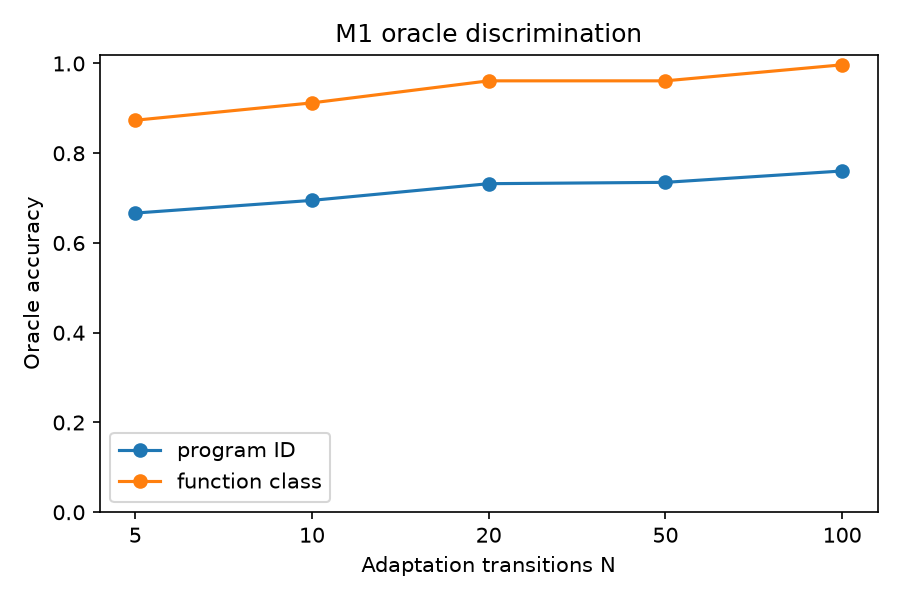
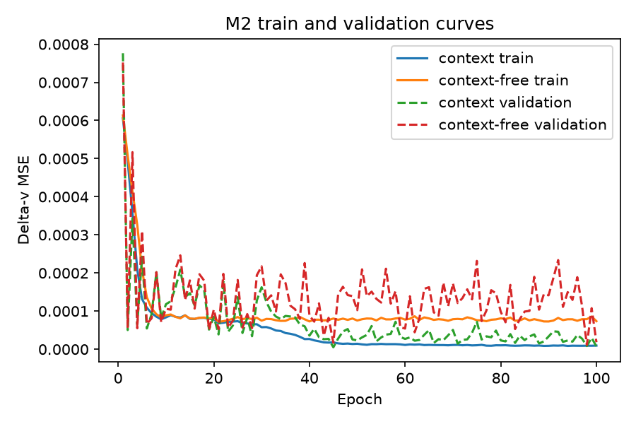
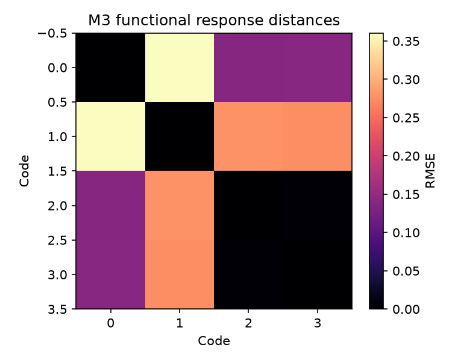
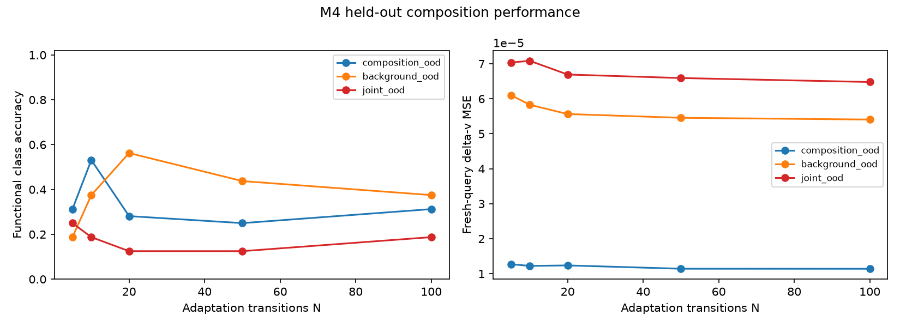

# Q1 run report

Run directory: `results/q1/cpu_confirmatory_impl`

## M1

Oracle gate: **PASS**.
Functional-class accuracy accounts for observationally equivalent programs.

## M2

Validation MSE: context 2.65704e-05; context-free 0.000115131; relative improvement 76.92%.
Context-swap response RMSE: 0.00116408.

## M3

Average transfer MSE: 0.0384626; persistence 0.113063; wrong-code 0.169864.

## M4

Length penalty selected on validation: 0.
Gate: **FAIL**; best direct-context query MSE gain 83.09%; mean held-out class accuracy 0.256.

